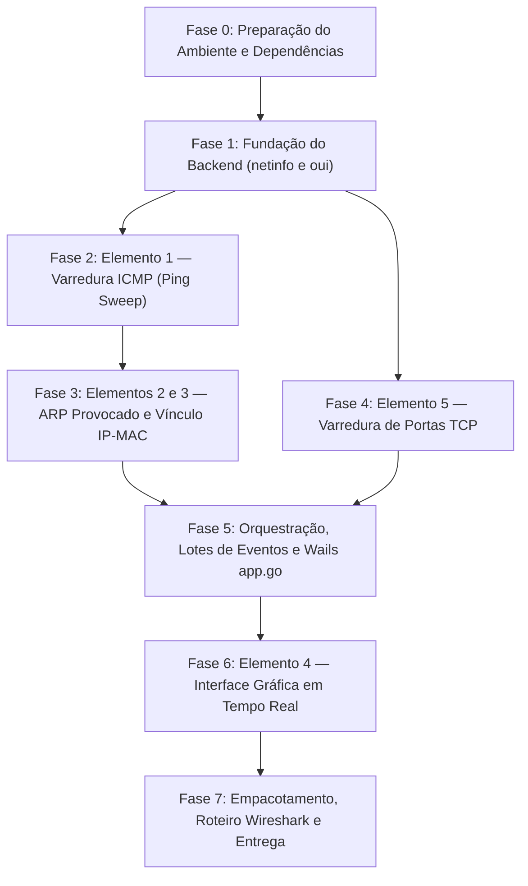

# Checklist de Fases do Projeto — netprobe-wifi

Este documento rastreia o ciclo de vida completo do desenvolvimento do **netprobe-wifi**, desde a preparação do ambiente até a entrega acadêmica final com demonstração no Wireshark.

---

## Visão Geral das Fases

---

## Detalhamento das Fases e Entregas

### [x] Fase 0 — Preparação do Ambiente e Ferramental
- [x] Configurar Go estável (1.27.x) no PATH do sistema.
- [x] Verificar Node.js LTS (v24.x) e gerenciador de pacotes npm.
- [x] Instalar CLI do Wails v2 estável (`v2.16.0`).
- [x] Instalar bibliotecas de desenvolvimento Linux para WebKit 4.1 (`libwebkit2gtk-4.1-dev`, `libgtk-3-dev`).
- [x] Mapear tag de build necessária para Linux moderno: `-tags webkit2_41`.
- [x] Instalar ferramentas de qualidade: `govulncheck` e `golangci-lint`.

---

### [x] Fase 1 — Fundação do Backend (`netinfo` e `oui`)
- [x] Inicializar repositório Git, `.gitignore` e módulo Go (`netprobe-wifi`).
- [x] **Pacote `internal/netinfo`:**
  - [x] Validação e política estrita de alvos no backend (`target.go`).
  - [x] Permissão automática de redes privadas (RFC 1918) e Link-Local.
  - [x] Bloqueio incondicional de loopback (`127.0.0.1`), multicast (`224.0.0.0/4`) e broadcast.
  - [x] Bloqueio preventivo de IPs públicos por padrão (exige confirmação explícita).
  - [x] Alerta para faixas amplas maiores que `/20` (`IsLargeRange: true`), sem restrição artificial de tamanho.
  - [x] Enumeração em streaming (`IterateHosts`) com suporte a cancelamento de contexto e proteção contra estouro de memória (`Hosts(maxLimit)`).
  - [x] Exclusão automática do próprio IP, endereço de rede e endereço de broadcast.
  - [x] Listagem e filtragem de adaptadores de rede ativos IPv4 (`iface.go`).
  - [x] Resolução da interface padrão via consulta de rota UDP (`route.go`) com garantia de **zero pacotes transmitidos**.
- [x] **Pacote `internal/oui`:**
  - [x] Parsing de múltiplos formatos de MAC e normalização para `AA:BB:CC:DD:EE:FF`.
  - [x] Detecção do bit *Locally Administered* para classificação de MACs privados/aleatórios de smartphones e notebooks (`KindPrivate`).
  - [x] Base oficial MA-L da IEEE embutida via `//go:embed` e compactada em gzip (40.333 fabricantes em apenas 378 KB).
  - [x] Algoritmo de busca binária $O(\log N)$ em memória, 100% offline e thread-safe.
  - [x] Ferramenta geradora autônoma (`internal/oui/gen`) para atualização da base via `go generate`.
- [x] **Documentação e Testes:**
  - [x] Decisões de arquitetura documentadas (Arquitetura e Stack, Base OUI e Política de Alvos).
  - [x] 100% dos testes unitários passando com detector de concorrência (`go test -race ./...`).
  - [x] Compilação cruzada para Windows validada com sucesso (`GOOS=windows go build ./...`).
  - [x] Teste de diagnóstico real na máquina executado com sucesso (reconheceu interface Wi-Fi `wlp2s0` e fabricante Liteon).

---

### [x] Fase 2 — Elemento 1: Varredura ICMP (Ping Sweep)
- [x] Definir a interface `Pinger` multiplataforma injetável via construtor.
- [x] Implementar mecanismo Linux: socket datagrama ICMP não privilegiado com fallback para raw socket (`cap_net_raw`).
- [x] Implementar mecanismo Windows: chamadas nativas à API `IcmpSendEcho` (iphlpapi.dll) sem exigir elevação de administrador.
- [x] Desenvolver motor de sweep com worker pool limitado e controle de taxa de pacotes por segundo (pacotes/s).
- [x] Medição precisa de tempo de ida e volta (RTT - Round Trip Time) com timestamp embutido no payload.
- [x] Cancelamento gracioso e interrupção imediata via `context.Context` com garantia de zero vazamento de goroutines.
- [x] Diagnóstico de capacidades no Linux (`CheckCapabilities`) para orientar a interface gráfica com elevação simples via `pkexec`.
- [x] Testes unitários determinísticos com `FakePinger`, verificação de rate limiter e concorrência com `-race`.

---

### [x] Fase 3 — Elementos 2 e 3: ARP Provocado e Vínculo IP ↔ MAC
- [x] Implementar gatilho de resolução de vizinhos provocado pelo kernel (exclusivamente para IPs da sub-rede local que não responderam a ICMP).
  - [x] Mecanismo Linux: datagrama UDP curto para porta alta improvável provocando resolução ARP no kernel (`trigger_linux.go`).
  - [x] Mecanismo Windows: chamada `SendARP` da iphlpapi (`trigger_windows.go`).
- [x] Leitor e parser da tabela de vizinhos do sistema operacional:
  - [x] Linux: leitura de `/proc/net/arp` (`table_linux.go`).
  - [x] Windows: leitura via `GetIpNetTable` (`table_windows.go`).
- [x] Filtro de integridade: descarte de entradas incompletas (`INCOMPLETE` / flags `0x0`).
- [x] Filtro temporal: snapshot pré-varredura e diff para só aceitar entradas provocadas pela varredura atual.
- [x] Enriquecimento de fabricante integrando com `internal/oui`.
- [x] Rotulação explícita dos hosts encontrados como "Descoberto via ARP" (hosts com firewall ativo).
- [x] Testes unitários com fixtures de tabela ARP e cenários com e sem resposta (`table_linux_test.go`, `engine_test.go`).

---

### [x] Fase 4 — Elemento 5: Varredura de Portas TCP (Connect Scan)
- [x] Implementar interface `PortDialer` baseada em connect scan (handshake TCP completo com `net.Dialer` em `dialer.go`).
- [x] Validação rigorosa no backend: intervalo de portas (`1 <= início <= fim <= 65535`), timeout (200ms a 5000ms) e validação de alvos na sub-rede.
- [x] Semáforo de controle global com teto estrito de conexões simultâneas (padrão 200, máx 500), respeitando o `ulimit -n` do sistema.
- [x] Classificação precisa de resultados: Aberta (*Open*), Fechada (*Closed* / RST) e Filtrada (*Filtered* / timeout).
- [x] Mapeamento informativo de serviços conhecidos comuns (HTTP, SSH, HTTPS, DNS, SMB, etc. em `services.go`).
- [x] Cancelamento imediato do scan em andamento via `context.Context` com labeled break (`break scanLoop`).
- [x] Testes de integração locais utilizando `net.Listen` em `127.0.0.1` (`dialer_test.go`, `engine_test.go`).

---

### [x] Fase 5 — Orquestração de Rede, Lotes de Eventos e Wails Backend
- [x] Desenvolver o motor de orquestração unificado (ICMP Sweep -> ARP Provocado -> Enriquecimento OUI -> Port Scan sob demanda em `orchestrator.go`).
- [x] Implementar buffer agregador de eventos: emite lotes a cada ~100 ms para a UI (`aggregator.go`).
- [x] Definir estruturas de dados dos eventos fortemente tipadas e versionadas (`events.go`).
- [x] Inicializar o esqueleto de projeto Wails (`wails.json`, `main.go`, `app.go`).
- [x] Implementar a camada fina `app.go` expondo métodos ao frontend e convertendo erros para mensagens amigáveis.
- [x] Configurar inicialização em tema escuro nativo e CSP restritivo (`main.go`).
- [x] Validar compilação cruzada para Windows e compilação Linux com `go build -tags webkit2_41 .`.

---

### [x] Fase 6 — Elemento 4: Interface Gráfica em Tempo Real (React + shadcn/ui)
- [x] Setup do frontend em `frontend/`: React 19, TypeScript (`strict`), Tailwind CSS e componentes acessíveis.
- [x] Implementar janela frameless moderna (`Frameless: true`) com barra de controle customizada (`TitleBar.tsx`).
- [x] Design com estética minimalista e *Organic Modernism* (fundo grafite suave `#121214`, superfícies foscas `#18181c`, acentos naturais em verde sálvia `#84a98c` e terracota `#d97706`).
- [x] Painel superior de controles: seletor de adaptadores de rede, campo CIDR com autocompletar e alerta de rede ampla (> /20), sliders colapsáveis de taxa/timeout e botão Iniciar/Cancelar (`Controls.tsx`).
- [x] Barra de progresso dinâmica em tempo real e contadores consolidados (`MetricsGrid.tsx`):
  - Total de hosts escaneados
  - Hosts ativos encontrados
  - Descobertos via ICMP
  - Descobertos via ARP (firewall)
  - Hosts offline
- [x] Tabela em tempo real de hosts com busca textual e exportação para CSV (`HostTable.tsx`):
  - Endereço IP e Endereço MAC formatado
  - Fabricante identificado (com badge para MAC randômico/privado)
  - RTT do ping
  - Indicador de status (ICMP / ARP)
  - Ação para disparar varredura de portas TCP do host selecionado
- [x] Painel deslizante lateral (Opção A: *Slide-over Drawer* em `PortDrawer.tsx`) com configuração de portas, presets rápidos e tabela de resultados em tempo real.
- [x] Textos, labels e avisos 100% em português (pt-BR).
- [x] Testes de componentes com Vitest e Testing Library (11 testes automatizados passando).

---

### [x] Fase 7 — Empacotamento, Roteiro Wireshark e Entrega Final
- [x] Documentar roteiro de demonstração acadêmica passo a passo para o professor (`docs/roteiro-wireshark.md`):
  - Filtros recomendados de exibição no Wireshark para cada um dos 5 elementos.
  - Explicação do tráfego legítimo gerado (ICMP Echo, datagrama UDP de gatilho, ARP Request/Reply, SYN/ACK).
- [x] Empacotamento e distribuição:
  - Pacote `.deb` para Linux (`build/linux/build-deb.sh`) com permissão `cap_net_raw` no `postinst`.
  - Instalador Windows (NSIS) configurado via Wails com verificação automática do WebView2 Runtime e manifesto `asInvoker`.
- [x] Roteiro de testes manuais em ambiente Windows (`docs/roteiro-testes-windows.md`).
- [x] Decisão de arquitetura formalizada (empacotamento e distribuição).
- [x] Revisão final de toda a documentação e código.

